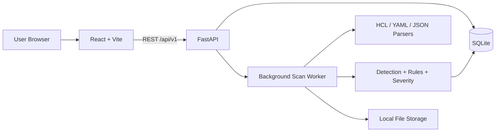

# Architecture Overview

**Enterprise Security Guardrail Auditor** — submission summary.

> Full v2.0 architecture (PRD, gap analysis, ER diagrams, UX spec): see [docs/ARCHITECTURE.md](docs/ARCHITECTURE.md)

## System context



## Design principles

| Principle | Implementation |
|-----------|----------------|
| Clean architecture | `domain` → `application` → `infrastructure` → `api` |
| API-first | All features exposed via REST; React UI is a client |
| Async scans | `POST /scans` returns `202`; client polls status |
| Security by default | Redaction, file validation, optional API key, rate limits |
| MVP scope | 10 rules, Terraform + CloudFormation, PDF/CSV export |

## Backend layers

```
backend/app/
├── api/              # Routes, middleware, schemas, exception handlers
├── application/      # Scan, dashboard, report services (use cases)
├── domain/
│   ├── engine/       # DetectionEngine, SeverityEngine, RulesEngine, detectors
│   ├── models/       # Scan, Finding, Resource domain types
│   └── services/     # Scoring, redaction, deduplication
└── infrastructure/   # SQLAlchemy repos, parsers, storage, PDF/CSV, workers
```

## Scan pipeline

1. **Upload** — multipart files validated (extension, size, UTF-8, basename).
2. **Parse** — `terraform_parser`, `cloudformation_parser` → `NormalizedResource[]`.
3. **Normalize** — link S3 access blocks, flatten SG ingress, map CFN fields.
4. **Detect** — 10 detectors produce raw detections.
5. **Score** — penalty weights → security score (0–100) + grade.
6. **Redact** — secrets stripped from evidence before persistence.
7. **Persist** — findings, severity counts, scores on `scans` row.

## Security rules (10)

| Rule ID | Description |
|---------|-------------|
| `S3_PUBLIC` | Public S3 bucket ACL or missing access block |
| `SG_SSH_OPEN` | SSH port 22 open to 0.0.0.0/0 |
| `SG_RDP_OPEN` | RDP port 3389 open to 0.0.0.0/0 |
| `IAM_WILDCARD` | IAM policy with `*` action or resource |
| `MISSING_ENCRYPTION` | Storage without encryption at rest |
| `DB_PUBLIC` | Publicly accessible database |
| `MISSING_LOGGING` | S3 bucket without access logging |
| `MISSING_BACKUP` | RDS backup retention or S3 versioning missing |
| `HARDCODED_SECRET` | Passwords/secrets in IaC source |
| `SG_OVERLY_PERMISSIVE` | All ports open from internet |

## Risk scoring

| Severity | Penalty points |
|----------|----------------|
| Critical | 10 |
| High | 7 |
| Medium | 4 |
| Low | 1 |
| Info | 0 |

**Security score** = `100 - min(100, total_penalty)`

| Score | Grade |
|-------|-------|
| 90–100 | Excellent |
| 70–89 | Good |
| 50–69 | Warning |
| 0–49 | Critical |

## Database (SQLite)

| Table | Purpose |
|-------|---------|
| `scans` | Scan metadata, scores, severity counts, status |
| `uploaded_files` | File metadata and storage paths |
| `findings` | Security findings per scan |
| `parse_errors` | Per-file parse failures |
| `scan_rules` | Rule catalog (seeded) |
| `reports` | Report metadata (optional) |

WAL mode enabled. Migrations via Alembic.

## Frontend structure

```
frontend/src/
├── api/           # HTTP client, scans, dashboard, reports
├── components/    # Charts, tables, filters, layout, badges
├── features/      # Dashboard, Upload, Scans, Reports pages
├── hooks/         # useDashboard, useScans, useScanPolling
└── lib/           # Constants, scoring, upload limits, errors
```

## API surface

Base URL: `/api/v1` — full reference in [docs/API.md](docs/API.md)

Interactive docs (development only): http://127.0.0.1:8000/docs

## Test strategy

| Layer | Location | Count |
|-------|----------|-------|
| Unit — rules | `tests/unit/rules/` | 20 |
| Unit — engine/scoring | `tests/unit/` | 20+ |
| Integration — API | `tests/integration/` | 10+ |
| Dataset validation | `tests/fixtures/dataset/` | 22 IaC samples |

**Total: 75 automated tests**

## Related documents

| Document | Description |
|----------|-------------|
| [docs/ARCHITECTURE.md](docs/ARCHITECTURE.md) | Full v2.0 approved architecture |
| [docs/ROADMAP.md](docs/ROADMAP.md) | 7-phase implementation roadmap |
| [docs/API.md](docs/API.md) | REST API reference |
| [INSTALLATION.md](INSTALLATION.md) | Setup instructions |
| [prompts.md](prompts.md) | AI audit log (Entries 1–11) |
