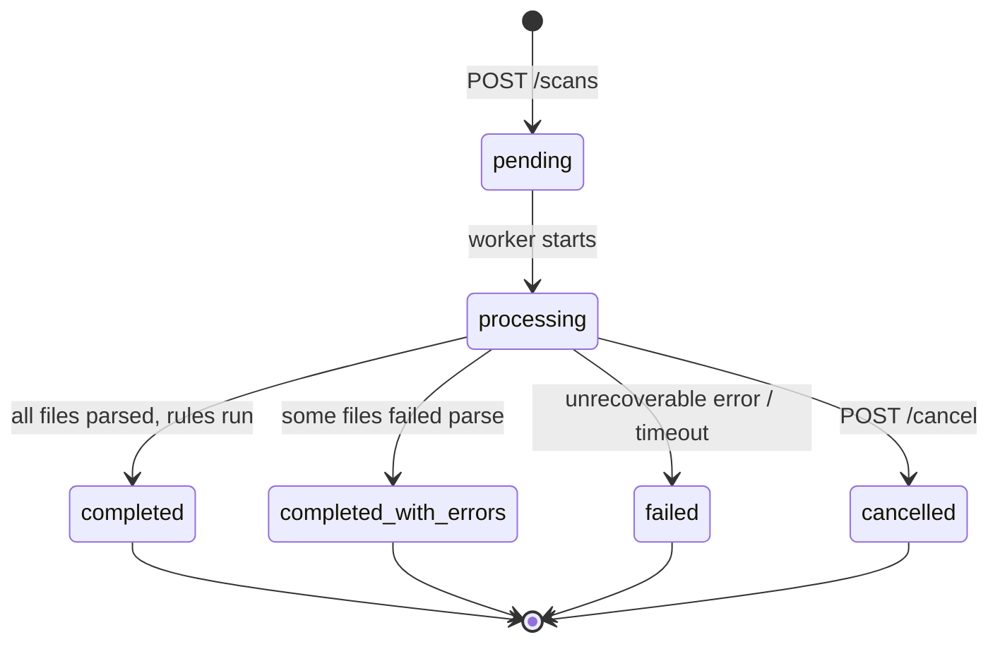
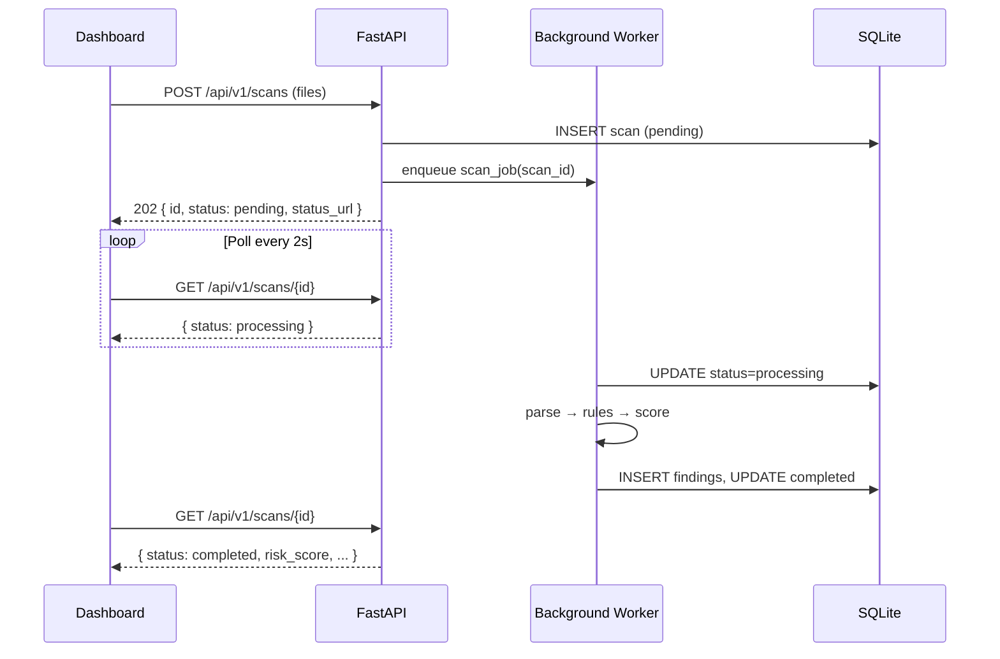
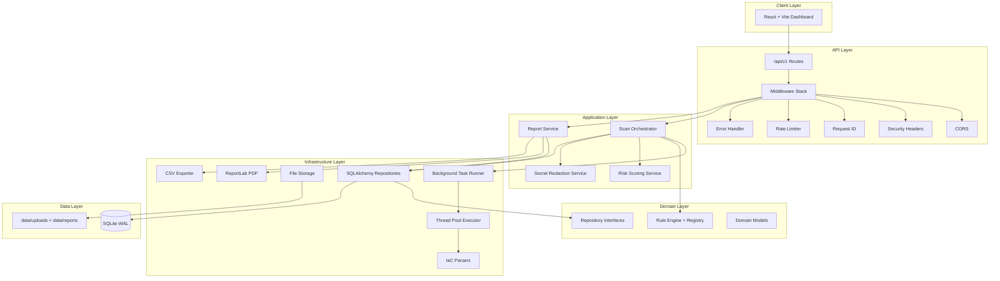
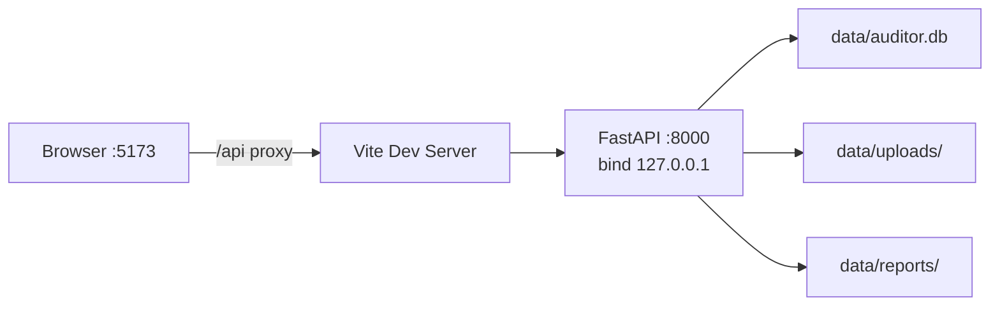
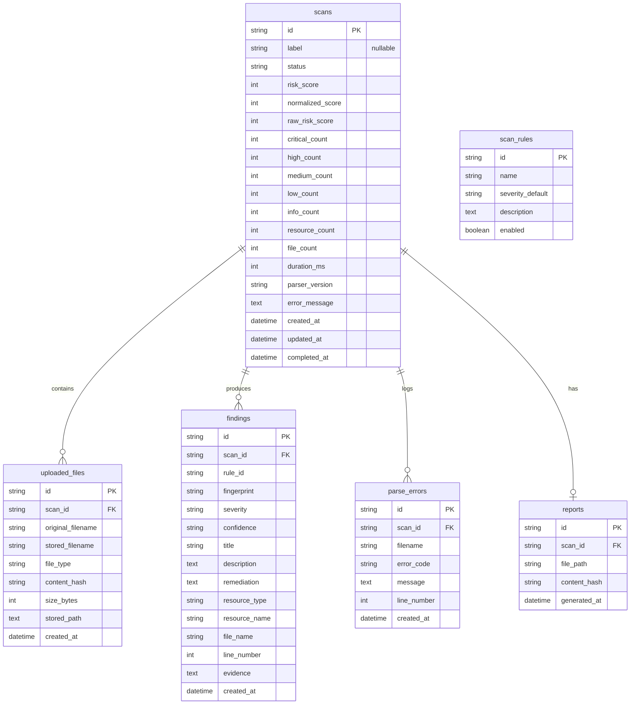

# Enterprise Security Guardrail Auditor — Architecture Document

**Version:** 2.0  
**Status:** ✅ Approved — Ready for Implementation  
**Approved by:** Principal Architect Review  
**Date:** 2026-06-17  
**Stack:** FastAPI · SQLAlchemy · SQLite · React · Vite · Recharts

---

## Document Control

| Version | Date | Author | Changes |
|---------|------|--------|---------|
| 1.0 | 2026-06-17 | Lead Architect | Initial draft — six deliverables |
| 2.0 | 2026-06-17 | Principal Architect | Gap analysis, design hardening, approval |

---

## Table of Contents

0. [Executive Summary](#0-executive-summary)
1. [Architecture Review & Gap Analysis](#1-architecture-review--gap-analysis)
2. [Design Improvements Applied](#2-design-improvements-applied)
3. [Product Requirements Document (PRD)](#3-product-requirements-document-prd)
4. [System Architecture](#4-system-architecture)
5. [Database Schema](#5-database-schema)
6. [API Design](#6-api-design)
7. [UX Design Specification](#7-ux-design-specification)
8. [Security & Compliance](#8-security--compliance)
9. [Folder Structure](#9-folder-structure)
10. [Development Plan](#10-development-plan)
11. [Appendices](#11-appendices)

---

## 0. Executive Summary

This document is the **approved architecture** for the Enterprise Security Guardrail Auditor MVP. Version 2.0 incorporates a Principal Architect review of v1.0, closing 47 identified gaps across requirements, edge cases, security, scalability, API design, database integrity, and UX.

**Key design decisions (v2.0):**

| Decision | Rationale |
|----------|-----------|
| **Async scan execution** with polling | Prevents HTTP timeouts; supports large uploads |
| **Partial-success scan status** | Some files may fail parse while others succeed |
| **Secret redaction** before persistence/display | Uploaded IaC often contains credentials |
| **Paginated findings by default** | Avoids multi-MB JSON responses |
| **SQLite WAL mode** + thread-pool parsing | Improves concurrency within MVP constraints |
| **Explicit file-safety pipeline** | Reject dangerous extensions, path traversal, binary content |
| **Repository interfaces in domain** | True dependency inversion per clean architecture |

**MVP remains in scope:** Terraform + CloudFormation upload, 10 security rules, risk score, dashboard, scan history, PDF export. No application code is included in this document.

---

## 1. Architecture Review & Gap Analysis

### 1.1 Missing Requirements (v1.0 → v2.0)

| # | Gap | Severity | Resolution |
|---|-----|----------|------------|
| R1 | Synchronous `POST /scans` blocks until complete; HTTP clients timeout on large scans | High | Async scan job with `202 Accepted` + status polling |
| R2 | FR-06 promises file re-download but no API endpoint exists | High | `GET /scans/{id}/files/{file_id}` added |
| R3 | No partial-parse handling when some files fail | High | `completed_with_errors` status + `parse_errors` table |
| R4 | `.tf.json` (Terraform JSON syntax) not listed | Medium | Added to supported formats |
| R5 | No scan label/name for history identification | Medium | Optional `label` field on scan creation |
| R6 | No scan duration or performance metadata | Medium | `duration_ms`, `parser_version` on scans |
| R7 | `scan_rules.enabled` in DB but no API to query/toggle | Low | `GET /rules` retained; toggle deferred post-MVP |
| R8 | No readiness probe (DB connectivity) | Medium | `GET /health/ready` added |
| R9 | No observability strategy (structured logging, request IDs) | Medium | Logging middleware + `request_id` in all responses |
| R10 | No rate limiting | Medium | In-memory rate limiter (60 req/min/IP, MVP) |
| R11 | No data retention / disk cleanup policy | Medium | Cascade delete on scan removal; optional `MAX_SCANS` config |
| R12 | No export format besides PDF | Low | `GET /scans/{id}/findings.csv` added to MVP |
| R13 | Empty scan (zero resources) undefined | Medium | Valid completion with score `0`, info finding optional |
| R14 | `.tfstate` / key files not explicitly rejected | Critical | Blocklist: `.tfstate`, `.pem`, `.key`, `.p12`, `.env` |
| R15 | ZIP archive upload (common IaC pattern) | Low | Post-MVP; documented |
| R16 | Finding confidence / false-positive signal | Low | `confidence` enum on findings (`high`, `medium`, `low`) |
| R17 | Idempotency for duplicate uploads | Low | `content_hash` dedup issues info-level notice, not block |
| R18 | Windows-specific dev experience | Medium | PowerShell startup script in dev plan |

### 1.2 Edge Cases

| # | Edge Case | Handling |
|---|-----------|----------|
| E1 | Empty file (0 bytes) | Reject with `400`; do not create scan |
| E2 | Binary file renamed to `.tf` | Content sniff: must be valid UTF-8 text; reject binary |
| E3 | Path traversal filename (`../../etc/passwd`) | Sanitize to basename only; reject `..` segments |
| E4 | Duplicate filenames in one batch | Suffix with `(2)`, `(3)` on storage; preserve original name in metadata |
| E5 | Unicode / very long filenames | NFC normalize; truncate stored name to 255 chars |
| E6 | 1000+ findings per scan | Paginate API; PDF multi-page with table continuation |
| E7 | Scan deleted during PDF generation | Return `404`; abort generation if scan missing |
| E8 | Concurrent PDF requests for same scan | Mutex per `scan_id`; serve cached file if fresh |
| E9 | HCL with only `variable`/`data` blocks, no resources | Complete with `resource_count=0`, score `0` |
| E10 | CloudFormation intrinsic functions (`!Ref`, `Fn::Sub`) | Static evaluation where possible; mark property `unresolved` otherwise |
| E11 | Terraform `count`/`for_each` | Expand to indexed resource instances in normalizer |
| E12 | Inline vs standalone security group rules | Normalizer flattens both into `ingress_rules[]` |
| E13 | S3 public access block as separate resource | Rule engine joins related resources by bucket name/tag |
| E14 | YAML billion-laughs attack | PyYAML `safe_load` only; max file size 10 MB |
| E15 | `.tfvars` with secrets but no resources | Secrets rule scans raw file content, not just resources |
| E16 | All findings Critical → score > 100 | Cap at 100; store raw weighted sum as `raw_risk_score` |
| E17 | Zero findings after successful parse | `risk_score = 0`; dashboard shows "No issues detected" |
| E18 | Mixed Terraform + CloudFormation in one scan | Supported; parser routes by extension per file |
| E19 | Clock / timezone ambiguity | All timestamps UTC ISO-8601 with `Z` suffix |
| E20 | Evidence contains actual secrets | Redact before DB insert and API response (see §8) |

### 1.3 Security Concerns

| # | Concern | OWASP / Category | Mitigation |
|---|---------|------------------|------------|
| S1 | No authentication | A01 Broken Access Control | Bind API to `127.0.0.1` by default; document LAN exposure risk |
| S2 | Path traversal in uploads | A01 | Basename sanitization + storage outside web root |
| S3 | Secrets stored on disk unencrypted | A02 Cryptographic Failures | Document risk; redact in evidence; restrict directory permissions `0700` |
| S4 | Secrets returned in API/PDF | A02 | Redaction pipeline (see §8.3) |
| S5 | XSS via finding evidence in UI | A03 Injection | React auto-escape; no `dangerouslySetInnerHTML`; CSP header |
| S6 | Unrestricted upload size (DoS) | A05 Security Misconfiguration | 10 MB/file, 50 MB/batch, max 20 files |
| S7 | CPU exhaustion via huge parses | A05 | Scan timeout 60s; thread pool with max workers |
| S8 | OpenAPI `/docs` in production | A05 | Disabled when `ENV=production` |
| S9 | Verbose stack traces to client | A05 | Generic `500` message; log details server-side only |
| S10 | CORS wildcard | A05 | Explicit origin allowlist from config |
| S11 | Missing security headers | A05 | Middleware: `X-Content-Type-Options`, `X-Frame-Options`, `CSP` |
| S12 | Content-Type spoofing | A04 Insecure Design | Extension whitelist + UTF-8 text validation |
| S13 | SQL injection via sort param | A03 | Allowlist sort fields: `created_at`, `risk_score`, `status` |
| S14 | SQLite DB world-readable | A02 | Create `data/` with restricted permissions |
| S15 | Rate limit bypass | A05 | Per-IP in-memory limiter; 429 response |
| S16 | PDF injection via evidence text | A03 | Escape/sanitize all dynamic PDF text |
| S17 | Dependency vulnerabilities | A06 | `pip-audit` / `npm audit` in CI (Phase 5) |

### 1.4 Scalability Issues

| # | Issue | MVP Mitigation | Scale-Out Path |
|---|-------|----------------|----------------|
| SC1 | Synchronous scan blocks API worker | Background task + polling | Celery + Redis queue |
| SC2 | SQLite single-writer | WAL mode; short transactions | PostgreSQL |
| SC3 | Full findings in POST response | Summary only; paginate findings | Cursor pagination |
| SC4 | CPU-bound parse blocks event loop | `run_in_executor` thread pool | Dedicated worker processes |
| SC5 | Dashboard aggregates on every request | SQL aggregation with indexes; 60s in-memory cache | Materialized views / Redis |
| SC6 | Unbounded disk growth | Delete cascades files; optional `MAX_SCANS` eviction | S3 object storage |
| SC7 | Local file storage tied to instance | Acceptable for MVP | Shared volume / object store |
| SC8 | PDF regeneration cost | Cache PDF on disk; invalidate on scan update | CDN / object cache |
| SC9 | Trend query full table scan | Index on `scans.completed_at` | Time-series DB |
| SC10 | No horizontal scaling | Document single-instance limit | Stateless API + external DB/storage |

### 1.5 API Issues

| # | Issue | Resolution |
|---|-------|------------|
| A1 | `POST /scans` returns 201 with full body synchronously | `202 Accepted` with `{ id, status, status_url }`; poll `GET /scans/{id}` |
| A2 | Health at `/health` inconsistent with `/api/v1` prefix | `GET /api/v1/health` (liveness) + `GET /api/v1/health/ready` |
| A3 | No file download endpoint | `GET /scans/{id}/files/{file_id}` |
| A4 | Ambiguous `open_critical_findings` on dashboard | Defined: count from **most recent completed scan** |
| A5 | No `409 Conflict` for operations on in-progress scan | `409 SCAN_IN_PROGRESS` on delete/report during processing |
| A6 | No `429 Too Many Requests` | Added with `Retry-After` header |
| A7 | `GET /scans/{id}` always includes all findings | `?include=findings,files,parse_errors` (findings excluded by default) |
| A8 | Sort param injection risk | Allowlist documented |
| A9 | No scan cancel | `POST /scans/{id}/cancel` (best-effort, MVP) |
| A10 | PDF cache semantics undefined | `ETag` + `If-None-Match` support; `Cache-Control: private` |
| A11 | Multipart max file count unspecified | Max 20 files per scan |
| A12 | Missing `scan:read`, `scan:write` scope design | Header `X-API-Key` reserved; no enforcement in MVP |
| A13 | Error codes incomplete | Added: `SCAN_IN_PROGRESS`, `SCAN_FAILED`, `RATE_LIMITED`, `SCAN_TIMEOUT` |
| A14 | No webhook on completion | Post-MVP |
| A15 | Inconsistent list vs detail scan shape | Shared `ScanSummary` and `ScanDetail` schemas |

### 1.6 Database Issues

| # | Issue | Resolution |
|---|-------|------------|
| D1 | FK cascade behavior undocumented | `ON DELETE CASCADE` on all child tables |
| D2 | Denormalized severity counts can drift | Recomputed in same transaction as findings insert |
| D3 | No per-file parse error storage | New `parse_errors` table |
| D4 | No finding deduplication | `fingerprint` column; unique index `(scan_id, fingerprint)` |
| D5 | Missing `updated_at` on scans | Added |
| D6 | Missing `duration_ms` | Added |
| D7 | Orphan PDF files on rescan | Delete old report file before regenerate |
| D8 | SQLite concurrency | Enable WAL: `PRAGMA journal_mode=WAL` |
| D9 | No index for trend queries | `idx_scans_completed_at` |
| D10 | `evidence` unbounded size | Truncate to 4 KB at persistence; note in finding |
| D11 | Delete scan leaves files on disk | Repository delete in transaction: DB then filesystem |
| D12 | No migration rollback policy | Alembic downgrade scripts required per migration |
| D13 | `scan_rules` not linked to findings | `rule_id` FK optional (soft reference for seed flexibility) |

### 1.7 UX Issues

| # | Issue | Resolution |
|---|-------|------------|
| U1 | No progress during scan | Poll `GET /scans/{id}` every 2s; progress bar + status text |
| U2 | No empty states | Designed empty states for dashboard, history, findings |
| U3 | No pre-upload validation | Client-side extension/size check before submit |
| U4 | Technical error messages | Map API error codes to user-friendly strings |
| U5 | No delete confirmation | Modal with scan label + finding count |
| U6 | No success/error toasts | Toast notifications on upload complete / fail |
| U7 | Dashboard stale after upload | Redirect to scan detail; invalidate dashboard cache |
| U8 | No file preview before scan | File list with name, size, type chips pre-submit |
| U9 | Parse warnings invisible | `ParseWarningsBanner` on scan detail |
| U10 | No remediation copy button | Copy-to-clipboard on remediation text |
| U11 | Risk score color-only severity | Icon + label alongside color (accessibility) |
| U12 | No keyboard navigation / a11y | Focus management, ARIA labels on interactive elements |
| U13 | No deep links | Routes: `/`, `/upload`, `/scans`, `/scans/:id`, `/dashboard` |
| U14 | No loading skeletons | Skeleton placeholders for dashboard cards and tables |
| U15 | Finding table not searchable | Client-side filter by resource, rule, severity |
| U16 | No rule explanation tooltips | Tooltip linking to rule description from `GET /rules` |
| U17 | Mobile layout undefined | Responsive breakpoints; sidebar collapses on `<768px` |

---

## 2. Design Improvements Applied

### 2.1 Scan Lifecycle State Machine



### 2.2 Async Scan Flow (v2.0)



### 2.3 Normalized Resource Model (Enhanced)

```
NormalizedResource
├── id: str                    # stable hash of type+name+file
├── source_file: str
├── source_line: int | null
├── provider: str              # "aws"
├── resource_type: str         # "aws_s3_bucket"
├── resource_name: str         # "logs" or "logs[0]"
├── properties: dict           # flattened key-value
├── related_resources: list    # linked resources (e.g. s3 + public_access_block)
├── resolution: enum           # resolved | partial | unresolved
└── raw_block: str             # truncated original snippet (max 2 KB)
```

### 2.4 Risk Scoring (Clarified)

```
raw_score   = Σ (severity_weight × count)   # weights: 25, 15, 8, 3, 1
risk_score  = min(100, raw_score)

If resource_count > 0:
  normalized_score = min(100, round(raw_score / sqrt(resource_count) * 2))
  # Store both risk_score (capped raw) and normalized_score (density-adjusted)
  # Dashboard displays risk_score; detail view shows both
```

### 2.5 File Safety Pipeline

```
Upload → extension whitelist → blocklist check → size check
      → UTF-8 text validation → basename sanitization
      → SHA-256 hash → store to data/uploads/{scan_id}/{safe_name}
```

---

## 3. Product Requirements Document (PRD)

### 3.1 Product Vision

*(Unchanged from v1.0 — see §0.)*

### 3.2 Goals (MVP)

| Goal | Success Metric |
|------|----------------|
| Ingest IaC files | `.tf`, `.tfvars`, `.tf.json`, `.json`, `.yaml`, `.yml`, `.template` |
| Detect 10 security rules | ≥ 90% true-positive rate on curated fixtures; ≤ 10% false-positive on clean fixtures |
| Quantify risk | 0–100 score per scan with severity breakdown |
| Visualize findings | Dashboard with ≥ 3 Recharts charts |
| Persist history | Paginated scans with label, status, score |
| Export reports | PDF + CSV per scan |

### 3.3 Functional Requirements (Updated)

#### FR-01: File Upload
- Single or multiple files; max **20 files**, **10 MB/file**, **50 MB/batch**.
- **Reject blocklist:** `.tfstate`, `.tfstate.backup`, `.pem`, `.key`, `.p12`, `.pfx`, `.env`.
- Optional `label` (max 120 chars) per scan.
- Returns `202 Accepted` immediately; scan runs asynchronously.

#### FR-02: IaC Parsing
- Terraform HCL, Terraform JSON (`.tf.json`), CloudFormation JSON/YAML.
- Per-file parse result: `success`, `warning`, or `error` recorded in `parse_errors`.
- Normalizer produces `NormalizedResource` with relationship linking.

#### FR-03: Security Rules

| Rule ID | Name | Severity | Detection Summary |
|---------|------|----------|-------------------|
| `S3_PUBLIC` | Public S3 Buckets | Critical | Public ACL, public policy principal `*`, or missing public access block |
| `SG_SSH_OPEN` | Open SSH Port 22 | High | `0.0.0.0/0` or `::/0` ingress on port 22 |
| `SG_RDP_OPEN` | Open RDP Port 3389 | High | `0.0.0.0/0` or `::/0` ingress on port 3389 |
| `IAM_WILDCARD` | Wildcard IAM Permissions | Critical | `Action: *`, `Resource: *`, or `*` in managed policy statement |
| `MISSING_ENCRYPTION` | Missing Encryption | High | S3/RDS/EBS/DynamoDB without encryption at rest enabled |
| `DB_PUBLIC` | Public Databases | Critical | `publicly_accessible = true` or open SG on DB ports |
| `MISSING_LOGGING` | Missing Logging | Medium | S3 access logging, CloudTrail, or VPC flow logs absent |
| `MISSING_BACKUP` | Missing Backups | Medium | RDS `backup_retention_period = 0`; S3 versioning disabled |
| `HARDCODED_SECRET` | Hardcoded Secrets | Critical | Literal secrets in resource properties or raw file (see §8.3) |
| `SG_OVERLY_PERMISSIVE` | Overly Permissive SG | High | `0.0.0.0/0` on all ports (`-1` or `0-65535`) |

Each finding includes: `confidence` (`high` | `medium` | `low`), `fingerprint`, redacted `evidence`.

#### FR-04: Risk Scoring
- Store `risk_score` (0–100 capped) and `normalized_score` (density-adjusted).
- Store `raw_risk_score` for audit.

#### FR-05: Dashboard
- Summary cards: total scans, latest risk score, latest critical count, last scan date.
- Charts: severity distribution (pie), risk trend (line, 30 days), findings by rule (bar).
- Auto-refresh after scan completion.

#### FR-06: Scan History
- Paginated list with label, status, score, file count, duration, timestamps.
- Detail view with findings table, parse errors, uploaded files.
- Re-download original files.
- Delete with cascade (DB + filesystem).

#### FR-07: Export
- **PDF:** executive summary, metadata, severity chart data, findings table.
- **CSV:** all findings columns for spreadsheet analysis.

### 3.4 Non-Functional Requirements (Updated)

| Category | Requirement |
|----------|-------------|
| Performance | Scan ≤ 60s for 20 files / 5 MB; API reads ≤ 200ms p95 |
| Reliability | Graceful partial failure; no data corruption on crash mid-scan |
| Security | OWASP Top 10 mitigations per §8 |
| Accessibility | WCAG 2.1 AA target for color + keyboard |
| Observability | Structured JSON logs with `request_id`, `scan_id` |
| Testability | ≥ 80% coverage on `domain/`; integration tests for all endpoints |

### 3.5 Acceptance Criteria (Updated)

1. Upload public S3 Terraform → `S3_PUBLIC` Critical finding with evidence.
2. Upload CFN with open SSH → `SG_SSH_OPEN` finding.
3. Upload mix of valid + corrupt file → `completed_with_errors` + parse error entry.
4. Dashboard renders 3 charts with real data.
5. Poll scan status until complete; UI shows progress.
6. PDF and CSV export download successfully.
7. Delete scan removes DB rows and files from disk.
8. Secret in upload → finding created with **redacted** evidence in API response.
9. `pytest` green.

---

## 4. System Architecture

### 4.1 Logical Architecture (v2.0)



### 4.2 Deployment Topology



### 4.3 Architectural Principles

| Principle | Application |
|-----------|-------------|
| Clean Architecture | Domain has zero imports from FastAPI/SQLAlchemy |
| API-First | Every UI action maps to a documented endpoint |
| Async by Default | Scans never block HTTP response |
| Fail Safe | Partial success preferred over total failure |
| Defense in Depth | Validate at API, storage, and parser layers |

---

## 5. Database Schema

### 5.1 Entity-Relationship Diagram (v2.0)



### 5.2 Key Schema Changes from v1.0

| Change | Purpose |
|--------|---------|
| `scans.label` | Human-readable scan identification |
| `scans.normalized_score`, `raw_risk_score` | Transparent scoring |
| `scans.duration_ms`, `parser_version` | Observability |
| `scans.updated_at` | Audit trail |
| `findings.fingerprint` + unique `(scan_id, fingerprint)` | Deduplication |
| `findings.confidence` | False-positive management |
| `parse_errors` table | Per-file failure tracking |
| `uploaded_files.original_filename` vs `stored_filename` | Safe storage naming |
| `reports.content_hash` | ETag support |
| `ON DELETE CASCADE` | All child FKs |

### 5.3 SQLite Configuration

```sql
PRAGMA journal_mode = WAL;
PRAGMA foreign_keys = ON;
PRAGMA busy_timeout = 5000;
```

### 5.4 Indexes

| Index | Table | Columns |
|-------|-------|---------|
| `idx_scans_created_at` | scans | `created_at DESC` |
| `idx_scans_completed_at` | scans | `completed_at DESC` |
| `idx_scans_status` | scans | `status` |
| `idx_findings_scan_id` | findings | `scan_id` |
| `idx_findings_scan_fingerprint` | findings | `scan_id, fingerprint` UNIQUE |
| `idx_parse_errors_scan_id` | parse_errors | `scan_id` |

---

## 6. API Design

**Base URL:** `/api/v1`  
**Auth (MVP):** None — localhost bind only. Reserve `X-API-Key` header for post-MVP.

### 6.1 Standard Envelope

```json
{
  "data": {},
  "meta": {
    "request_id": "uuid",
    "timestamp": "2026-06-17T12:00:00Z"
  }
}
```

### 6.2 Error Codes

| HTTP | Code | When |
|------|------|------|
| 400 | `VALIDATION_ERROR` | Invalid input |
| 404 | `NOT_FOUND` | Resource not found |
| 409 | `SCAN_IN_PROGRESS` | Operation conflicts with active scan |
| 413 | `PAYLOAD_TOO_LARGE` | Size limit exceeded |
| 415 | `UNSUPPORTED_MEDIA_TYPE` | Extension not allowed |
| 422 | `PARSE_ERROR` | All files failed parse |
| 429 | `RATE_LIMITED` | Rate limit exceeded |
| 500 | `INTERNAL_ERROR` | Unexpected error |
| 504 | `SCAN_TIMEOUT` | Scan exceeded 60s |

### 6.3 Endpoints (v2.0)

#### Health

| Method | Path | Description |
|--------|------|-------------|
| `GET` | `/health` | Liveness — returns `{ status: "ok", version }` |
| `GET` | `/health/ready` | Readiness — checks DB connectivity |

#### Scans

| Method | Path | Description |
|--------|------|-------------|
| `POST` | `/scans` | Upload files, enqueue scan → **202** |
| `GET` | `/scans` | Paginated history |
| `GET` | `/scans/{id}` | Scan detail; `?include=findings,files,parse_errors` |
| `POST` | `/scans/{id}/cancel` | Cancel in-progress scan |
| `DELETE` | `/scans/{id}` | Delete scan + files |

##### `POST /scans`

**Request:** `multipart/form-data`

| Field | Type | Required |
|-------|------|----------|
| `files` | File[] | Yes |
| `label` | string | No |

**Response 202:**
```json
{
  "data": {
    "id": "uuid",
    "label": "prod-vpc-review",
    "status": "pending",
    "status_url": "/api/v1/scans/uuid",
    "file_count": 3,
    "created_at": "2026-06-17T12:00:00Z"
  }
}
```

##### `GET /scans/{id}`

**Default response** (no includes): summary without findings.

**With `?include=findings`:** embed first 50 findings + `findings_url` for pagination.

#### Files

| Method | Path | Description |
|--------|------|-------------|
| `GET` | `/scans/{id}/files` | List uploaded files |
| `GET` | `/scans/{id}/files/{file_id}` | Download original file |

#### Findings

| Method | Path | Description |
|--------|------|-------------|
| `GET` | `/scans/{id}/findings` | Paginated; filter `severity`, `rule_id`, `q` |
| `GET` | `/scans/{id}/findings.csv` | CSV export |

#### Reports

| Method | Path | Description |
|--------|------|-------------|
| `GET` | `/scans/{id}/report.pdf` | PDF download; supports `ETag` |
| `POST` | `/scans/{id}/report` | Force regenerate PDF |

#### Rules & Dashboard

| Method | Path | Description |
|--------|------|-------------|
| `GET` | `/rules` | Rule catalog |
| `GET` | `/dashboard/summary` | Aggregate stats |
| `GET` | `/dashboard/trends` | `?days=30` |

##### Dashboard `summary` definitions

| Field | Definition |
|-------|------------|
| `latest_risk_score` | `risk_score` of most recent `completed` scan |
| `open_critical_findings` | `critical_count` of most recent `completed` scan |
| `findings_by_severity` | Sum across **all** findings in DB (historical) |
| `findings_by_rule` | Top 10 rules by total finding count |

### 6.4 Pagination

```
?page=1&page_size=20    # max page_size=100
```

List scans sort allowlist: `created_at`, `-created_at`, `risk_score`, `-risk_score`.

---

## 7. UX Design Specification

### 7.1 Information Architecture

```
/ ........................... Dashboard (default landing)
/upload ..................... Upload & Scan
/scans ...................... Scan History
/scans/:id .................. Scan Detail
```

### 7.2 Key User Flows

**Upload Flow**
1. Drag files → client validates extension/size → show file chips
2. Optional label input → Submit
3. Redirect to `/scans/:id` → poll status → progress bar
4. On complete → findings table + severity summary + export buttons

**Scan Detail**
- Header: label, status badge, risk score gauge, timestamps, duration
- Tabs: Findings | Files | Parse Errors
- Actions: Download PDF, Download CSV, Delete (with confirmation modal)

### 7.3 Component States

| Component | Empty | Loading | Error | Success |
|-----------|-------|---------|-------|---------|
| Dashboard | "Run your first scan" CTA | Skeleton cards | Error banner + retry | Charts + stats |
| Scan History | "No scans yet" | Table skeleton | Toast error | Paginated table |
| Findings Table | "No issues detected" | Spinner | — | Filterable rows |
| Upload | Drop zone | Progress bar + % | Inline file errors | Redirect to detail |

### 7.4 Accessibility

- Severity badges: color + icon + text label
- All buttons keyboard-focusable; modal trap focus
- Chart data available in table form (not color-only)
- `aria-live="polite"` on scan status polling region

### 7.5 Error Message Mapping

| API Code | User Message |
|----------|--------------|
| `PAYLOAD_TOO_LARGE` | "File too large. Maximum size is 10 MB per file." |
| `UNSUPPORTED_MEDIA_TYPE` | "File type not supported. Upload .tf, .json, .yaml, or .yml files." |
| `PARSE_ERROR` | "We couldn't parse any of the uploaded files. Check format and try again." |
| `SCAN_TIMEOUT` | "Scan took too long. Try uploading fewer or smaller files." |
| `RATE_LIMITED` | "Too many requests. Please wait a moment and retry." |

---

## 8. Security & Compliance

### 8.1 MVP Security Baseline

| Control | Implementation |
|---------|----------------|
| Network exposure | `HOST=127.0.0.1` default |
| Input validation | Pydantic schemas + file pipeline |
| Output encoding | JSON via Pydantic; React text nodes |
| Security headers | CSP, X-Frame-Options, X-Content-Type-Options |
| Logging | No raw file content or secrets in logs |
| Docs exposure | `/docs` disabled when `ENV=production` |

### 8.2 File Blocklist

```
.tfstate, .tfstate.backup, .pem, .key, .p12, .pfx, .env, .git, .exe, .dll, .zip (post-MVP)
```

### 8.3 Secret Redaction Pipeline

Before persisting or returning evidence:

1. Match patterns: AWS keys (`AKIA[0-9A-Z]{16}`), `password=`, `secret_key`, `api_key`, JWT-like strings, PEM headers.
2. Replace matched values with `[REDACTED]`.
3. Hardcoded-secret **findings** still created; evidence shows redacted form.
4. PDF uses same redacted evidence.

### 8.4 Data Handling

| Data | Retention | Delete Behavior |
|------|-----------|-----------------|
| Uploaded files | Until scan deleted | Filesystem unlink on cascade delete |
| SQLite records | Until scan deleted | CASCADE |
| PDF cache | Until scan deleted or regenerate | Old file unlinked |
| Logs | Ephemeral (stdout) | No PII |

---

## 9. Folder Structure

```
AI-Project/
├── prompts.md
├── rules.md
├── README.md
├── .gitignore
├── scripts/
│   ├── dev.ps1                         # Windows: start backend + frontend
│   └── dev.sh                          # Unix: start backend + frontend
│
├── docs/
│   └── ARCHITECTURE.md                 # This document (v2.0 Approved)
│
├── backend/
│   ├── pyproject.toml
│   ├── requirements.txt
│   ├── alembic.ini
│   ├── alembic/versions/
│   ├── data/                           # gitignored
│   ├── tests/
│   │   ├── unit/
│   │   │   ├── rules/                  # 10 rule test modules
│   │   │   ├── test_scoring.py
│   │   │   ├── test_redaction.py
│   │   │   └── parsers/
│   │   ├── integration/
│   │   └── fixtures/
│   └── app/
│       ├── main.py
│       ├── config.py
│       ├── api/
│       │   ├── middleware/             # NEW: security, rate limit, request_id
│       │   ├── routes/
│       │   └── schemas/
│       ├── application/                # NEW: explicit application layer
│       │   ├── scan_service.py
│       │   ├── report_service.py
│       │   └── dto/
│       ├── domain/
│       │   ├── models/
│       │   ├── rules/                  # 10 rule modules
│       │   ├── services/               # scoring, redaction
│       │   └── ports/                  # NEW: repository interfaces
│       └── infrastructure/
│           ├── database/
│           ├── repositories/
│           ├── parsers/
│           ├── storage/
│           ├── reports/                  # pdf_generator.py, csv_exporter.py
│           └── workers/                  # NEW: background scan runner
│
└── frontend/
    └── src/
        ├── api/
        ├── components/
        │   ├── layout/
        │   ├── common/
        │   └── charts/
        ├── features/
        │   ├── upload/
        │   ├── dashboard/
        │   ├── scans/
        │   └── reports/
        ├── hooks/
        │   ├── useScanPolling.ts         # NEW: 2s poll until terminal state
        │   └── useScans.ts
        ├── lib/
        │   └── errorMessages.ts          # NEW: API code → user string
        └── routes/
```

### 9.1 Dependency Choices (Confirmed)

| Component | Choice | Notes |
|-----------|--------|-------|
| PDF | ReportLab | Pure Python; no system deps |
| HCL | python-hcl2 | Terraform parsing |
| YAML | PyYAML (`safe_load`) | CFN templates |
| HTTP client (FE) | fetch + thin wrapper | No axios required |
| Styling | Tailwind CSS 3 | Utility-first MVP UI |

---

## 10. Development Plan

### 10.1 Phase Overview (Updated)

| Phase | Focus | Days | Exit Criteria |
|-------|-------|------|---------------|
| **1 — Foundation** | Scaffolding, DB, middleware, health | 1–4 | `/health/ready` 200; WAL enabled |
| **2 — Core Engine** | Parsers, normalizer, 10 rules, redaction, scoring | 5–13 | Fixture scans pass in isolation |
| **3 — API** | Async scans, all endpoints, CSV/PDF | 14–19 | Integration tests green |
| **4 — Frontend** | Upload+poll, dashboard, history, detail | 20–27 | Full E2E manual flow |
| **5 — Quality** | Tests, security review, audit scripts | 8–22 (parallel) | ≥ 80% domain coverage |
| **6 — Polish** | README, dev scripts, acceptance validation | 28–30 | All acceptance criteria met |

**Estimated duration:** ~30 working days.

### 10.2 Phase 1 Additions (from review)

- Security headers middleware
- Request ID middleware
- Rate limiter middleware
- SQLite WAL pragma on startup
- Repository port interfaces defined before implementations
- `application/` layer introduced

### 10.3 Phase 2 Additions

- `parse_errors` recording
- Finding `fingerprint` generation
- Secret redaction service + tests
- Thread pool wrapper for parsers
- Resource relationship linking (S3 + access block)

### 10.4 Phase 3 Additions

- Async `POST /scans` with background worker
- `POST /scans/{id}/cancel`
- File download endpoints
- CSV export
- ETag on PDF
- `include` query param on scan detail

### 10.5 Phase 4 Additions

- `useScanPolling` hook
- Parse warnings banner
- Empty states + skeletons
- Delete confirmation modal
- Copy remediation button
- Responsive sidebar

### 10.6 Definition of Done (v2.0)

- [ ] All 47 gap items addressed per §1 or explicitly deferred
- [ ] Async scan with polling works E2E
- [ ] 10 rules implemented with positive + negative fixtures
- [ ] Secret redaction verified in API + PDF
- [ ] PDF + CSV export functional
- [ ] Dashboard with 3 Recharts charts
- [ ] Cascade delete cleans DB + filesystem
- [ ] `pytest` ≥ 80% coverage on `domain/` and `application/`
- [ ] `scripts/dev.ps1` starts full stack on Windows
- [ ] `prompts.md` audit log maintained

### 10.7 Post-MVP Roadmap

1. API key authentication (`X-API-Key`)
2. ZIP upload extraction
3. Git repository URL scan
4. CI/CD GitHub Action
5. PostgreSQL + Celery workers
6. Scan comparison (diff)
7. Rule enable/disable API
8. Docker Compose deployment

---

## 11. Appendices

### Appendix A — Finding Fingerprint Algorithm

```
fingerprint = SHA256(rule_id + "|" + resource_type + "|" + resource_name + "|" + file_name + "|" + line_number)[:16]
```

Duplicates within a scan are suppressed; count available via rule summary.

### Appendix B — Secret Detection Patterns (MVP)

| Pattern | Example |
|---------|---------|
| AWS Access Key | `AKIA[0-9A-Z]{16}` |
| Named secret keys | `(?i)(password|secret|api_key|token|private_key)\s*=\s*"[^"]+"` |
| PEM block | `-----BEGIN (RSA |EC )?PRIVATE KEY-----` |

Exclude Terraform variable references: `var.*`, `${var.`, `!Ref`, `Fn::Ref`.

### Appendix C — v1.0 → v2.0 Traceability

All v1.0 content is preserved and extended. Sections renamed for clarity:

| v1.0 Section | v2.0 Section |
|--------------|--------------|
| §1 PRD | §3 PRD (enhanced) |
| §2 Architecture | §4 System Architecture |
| §3 Database | §5 Database Schema |
| §4 API | §6 API Design |
| §5 Folder Structure | §9 Folder Structure |
| §6 Dev Plan | §10 Development Plan |
| — | §1 Gap Analysis (new) |
| — | §7 UX Specification (new) |
| — | §8 Security (new) |

### Appendix D — Approval Sign-Off

| Role | Status | Date |
|------|--------|------|
| Principal Architect | ✅ Approved | 2026-06-17 |
| Implementation | ⏳ Pending | Awaiting Phase 1 start |

---

*End of Architecture Document v2.0 — Approved*
