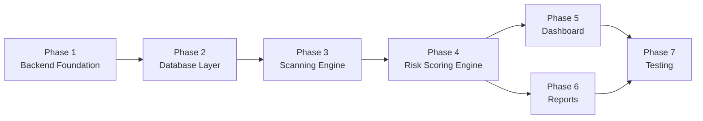

# Implementation Roadmap — Enterprise Security Guardrail Auditor

**Version:** 1.0  
**Status:** Approved for Execution  
**Based on:** `docs/ARCHITECTURE.md` v2.0  
**Date:** 2026-06-17

---

## Overview

This roadmap breaks the MVP into **7 sequential phases**. Each phase lists every file to create, upstream dependencies (phases and packages), and measurable acceptance criteria.



**Estimated duration:** ~30 working days (single developer).

| Phase | Name | Est. Days | Primary Output |
|-------|------|-----------|----------------|
| 1 | Backend Foundation | 3 | Runnable FastAPI app with middleware + health |
| 2 | Database Layer | 3 | SQLite schema, migrations, repositories |
| 3 | Scanning Engine | 8 | Parsers, 10 rules, async scan pipeline |
| 4 | Risk Scoring Engine | 2 | Scoring, redaction, scan completion |
| 5 | Dashboard | 7 | React UI + dashboard/scan APIs |
| 6 | Reports | 3 | PDF + CSV export |
| 7 | Testing | 4 | Full test suite + hardening (overlaps prior phases) |

---

## Phase 1: Backend Foundation

### Objective

Establish the FastAPI application shell, configuration, middleware stack, error handling, and project hygiene. No database or business logic yet.

### Phase Dependencies

| Type | Dependency |
|------|------------|
| Prior phases | None (starting point) |
| External | Python 3.11+, pip or Poetry |

### Python Package Dependencies

| Package | Version | Purpose |
|---------|---------|---------|
| `fastapi` | ≥ 0.110 | Web framework |
| `uvicorn[standard]` | ≥ 0.27 | ASGI server |
| `pydantic` | ≥ 2.5 | Validation |
| `pydantic-settings` | ≥ 2.1 | Environment config |
| `python-multipart` | ≥ 0.0.9 | Multipart support (future uploads) |

### Dev Dependencies

| Package | Purpose |
|---------|---------|
| `pytest` | Test runner |
| `httpx` | Async test client |
| `ruff` | Linting |

### Files to Create

#### Repository Root

| File | Purpose |
|------|---------|
| `.gitignore` | Ignore `data/`, `__pycache__`, `.env`, `node_modules`, `dist` |
| `README.md` | Project overview; placeholder for setup instructions |

#### Backend Root

| File | Purpose |
|------|---------|
| `backend/pyproject.toml` | Project metadata and dependency groups |
| `backend/requirements.txt` | Pinned runtime + dev dependencies |
| `backend/app/__init__.py` | Package marker |
| `backend/app/main.py` | FastAPI app factory, lifespan hook, router registration |
| `backend/app/config.py` | `Settings` class: `HOST`, `PORT`, `ENV`, `CORS_ORIGINS`, `LOG_LEVEL`, `API_V1_PREFIX` |

#### API Layer

| File | Purpose |
|------|---------|
| `backend/app/api/__init__.py` | Package marker |
| `backend/app/api/deps.py` | Placeholder for shared dependencies (DB session stub) |
| `backend/app/api/router.py` | Aggregates all route modules under `/api/v1` |
| `backend/app/api/routes/__init__.py` | Package marker |
| `backend/app/api/routes/health.py` | `GET /health` liveness endpoint |
| `backend/app/api/schemas/__init__.py` | Package marker |
| `backend/app/api/schemas/common.py` | `MetaResponse`, `ErrorResponse`, `ErrorDetail` Pydantic models |

#### Middleware

| File | Purpose |
|------|---------|
| `backend/app/api/middleware/__init__.py` | Package marker |
| `backend/app/api/middleware/request_id.py` | Generate/propagate `X-Request-ID`; attach to response `meta` |
| `backend/app/api/middleware/security_headers.py` | `X-Content-Type-Options`, `X-Frame-Options`, `Content-Security-Policy` |
| `backend/app/api/middleware/rate_limiter.py` | In-memory 60 req/min/IP limiter; return `429` |
| `backend/app/api/middleware/error_handler.py` | Global exception handlers; consistent error envelope |
| `backend/app/api/middleware/logging.py` | Structured JSON logging with `request_id` |

#### Domain / Infrastructure Stubs

| File | Purpose |
|------|---------|
| `backend/app/domain/__init__.py` | Package marker |
| `backend/app/application/__init__.py` | Package marker |
| `backend/app/infrastructure/__init__.py` | Package marker |

#### Tests (Smoke)

| File | Purpose |
|------|---------|
| `backend/tests/__init__.py` | Package marker |
| `backend/tests/conftest.py` | `TestClient` / `AsyncClient` fixture |
| `backend/tests/integration/test_health.py` | Liveness endpoint test |

#### Runtime Data (gitignored, created at startup)

| Path | Purpose |
|------|---------|
| `backend/data/` | Root for DB, uploads, reports (directory created by app) |

### Acceptance Criteria

- [ ] `uvicorn app.main:app --host 127.0.0.1 --port 8000` starts without errors from `backend/`
- [ ] `GET /api/v1/health` returns `200` with `{ "status": "ok", "version": "<semver>" }`
- [ ] Every response includes `meta.request_id` (UUID format)
- [ ] Security headers present on all responses (`X-Content-Type-Options: nosniff`, `X-Frame-Options: DENY`)
- [ ] Unhandled exceptions return `500` with generic message; no stack trace in body
- [ ] `ENV=production` disables `/docs` and `/redoc`
- [ ] Rate limiter returns `429` with `Retry-After` after threshold exceeded
- [ ] CORS allows only configured origin (`http://localhost:5173` default)
- [ ] `pytest tests/integration/test_health.py` passes
- [ ] `ruff check backend/app` passes with zero errors

---

## Phase 2: Database Layer

### Objective

Implement SQLite persistence: ORM models, Alembic migrations, repository ports and implementations, WAL configuration, and readiness health check.

### Phase Dependencies

| Type | Dependency |
|------|------------|
| Prior phases | **Phase 1** complete (app shell, middleware, error handling) |
| External | None beyond Phase 1 packages |

### Python Package Dependencies (add to `requirements.txt`)

| Package | Version | Purpose |
|---------|---------|---------|
| `sqlalchemy` | ≥ 2.0 | ORM |
| `alembic` | ≥ 1.13 | Migrations |

### Files to Create

#### Alembic

| File | Purpose |
|------|---------|
| `backend/alembic.ini` | Alembic configuration |
| `backend/alembic/env.py` | Migration environment; imports ORM models |
| `backend/alembic/script.py.mako` | Migration template |
| `backend/alembic/versions/001_initial_schema.py` | Creates all tables, indexes, FK cascades |
| `backend/alembic/versions/002_seed_scan_rules.py` | Seeds 10 `scan_rules` rows |

#### Database Infrastructure

| File | Purpose |
|------|---------|
| `backend/app/infrastructure/database/__init__.py` | Package marker |
| `backend/app/infrastructure/database/base.py` | SQLAlchemy `DeclarativeBase` |
| `backend/app/infrastructure/database/session.py` | Engine factory, `SessionLocal`, WAL pragmas, `get_db` generator |
| `backend/app/infrastructure/database/models.py` | ORM: `Scan`, `UploadedFile`, `Finding`, `ParseError`, `Report`, `ScanRule` |

#### Domain Models (Pure)

| File | Purpose |
|------|---------|
| `backend/app/domain/models/__init__.py` | Package marker |
| `backend/app/domain/models/enums.py` | `ScanStatus`, `Severity`, `Confidence`, `FileType` enums |
| `backend/app/domain/models/scan.py` | Domain dataclass `Scan` |
| `backend/app/domain/models/finding.py` | Domain dataclass `Finding` |
| `backend/app/domain/models/resource.py` | `NormalizedResource` dataclass (used in Phase 3) |
| `backend/app/domain/models/parse_error.py` | Domain dataclass `ParseError` |

#### Repository Ports (Interfaces)

| File | Purpose |
|------|---------|
| `backend/app/domain/ports/__init__.py` | Package marker |
| `backend/app/domain/ports/scan_repository.py` | `IScanRepository` protocol |
| `backend/app/domain/ports/finding_repository.py` | `IFindingRepository` protocol |
| `backend/app/domain/ports/file_repository.py` | `IUploadedFileRepository` protocol |
| `backend/app/domain/ports/parse_error_repository.py` | `IParseErrorRepository` protocol |
| `backend/app/domain/ports/report_repository.py` | `IReportRepository` protocol |
| `backend/app/domain/ports/rule_repository.py` | `IScanRuleRepository` protocol |

#### Repository Implementations

| File | Purpose |
|------|---------|
| `backend/app/infrastructure/repositories/__init__.py` | Package marker |
| `backend/app/infrastructure/repositories/scan_repository.py` | SQLAlchemy `ScanRepository` |
| `backend/app/infrastructure/repositories/finding_repository.py` | SQLAlchemy `FindingRepository` |
| `backend/app/infrastructure/repositories/file_repository.py` | SQLAlchemy `UploadedFileRepository` |
| `backend/app/infrastructure/repositories/parse_error_repository.py` | SQLAlchemy `ParseErrorRepository` |
| `backend/app/infrastructure/repositories/report_repository.py` | SQLAlchemy `ReportRepository` |
| `backend/app/infrastructure/repositories/rule_repository.py` | SQLAlchemy `ScanRuleRepository` |
| `backend/app/infrastructure/repositories/mappers.py` | ORM ↔ domain model conversion |

#### API Updates

| File | Purpose |
|------|---------|
| `backend/app/api/deps.py` | **Update:** inject `get_db` session and repository instances |
| `backend/app/api/routes/health.py` | **Update:** add `GET /health/ready` — executes `SELECT 1` |
| `backend/app/main.py` | **Update:** run Alembic upgrade on startup (or document manual step) |

#### Tests

| File | Purpose |
|------|---------|
| `backend/tests/conftest.py` | **Update:** test DB fixture (in-memory SQLite or temp file) |
| `backend/tests/integration/test_health_ready.py` | Readiness probe test |
| `backend/tests/integration/test_repositories.py` | CRUD smoke tests for each repository |

### Schema Checklist (must exist after migration)

| Table | Key columns |
|-------|-------------|
| `scans` | `id`, `label`, `status`, `risk_score`, `normalized_score`, `raw_risk_score`, severity counts, `duration_ms`, `parser_version`, timestamps |
| `uploaded_files` | `original_filename`, `stored_filename`, `content_hash`, `stored_path` |
| `findings` | `fingerprint`, `confidence`, `evidence` (max 4 KB at app layer) |
| `parse_errors` | `filename`, `error_code`, `message`, `line_number` |
| `reports` | `file_path`, `content_hash`, `generated_at` |
| `scan_rules` | 10 seeded rows |

### Acceptance Criteria

- [ ] `alembic upgrade head` creates `backend/data/auditor.db` with all tables and indexes
- [ ] `PRAGMA journal_mode` returns `wal` after app startup
- [ ] `PRAGMA foreign_keys` is `ON`
- [ ] `GET /api/v1/health/ready` returns `200` when DB is reachable; `503` when DB is unavailable
- [ ] All 6 repository implementations pass CRUD integration tests
- [ ] `ON DELETE CASCADE` verified: deleting a scan removes child `findings`, `uploaded_files`, `parse_errors`, `reports`
- [ ] `scan_rules` table contains exactly 10 seeded rules matching architecture §3.3
- [ ] Domain models have zero imports from SQLAlchemy or FastAPI
- [ ] Repository mappers round-trip ORM ↔ domain without data loss

---

## Phase 3: Scanning Engine

### Objective

Build the IaC ingestion pipeline: file safety validation, storage, Terraform/CloudFormation parsers, resource normalizer, 10 security rules, secret redaction (detection only — full redaction service completed in Phase 4), async scan orchestration, and scan API endpoints.

### Phase Dependencies

| Type | Dependency |
|------|------------|
| Prior phases | **Phase 1** (API shell), **Phase 2** (repositories, domain models) |
| External | None beyond new packages below |

### Python Package Dependencies (add)

| Package | Version | Purpose |
|---------|---------|---------|
| `python-hcl2` | ≥ 4.3 | Terraform HCL parsing |
| `pyyaml` | ≥ 6.0 | CloudFormation YAML (`safe_load` only) |

### Files to Create

#### File Storage & Safety

| File | Purpose |
|------|---------|
| `backend/app/infrastructure/storage/__init__.py` | Package marker |
| `backend/app/infrastructure/storage/file_storage.py` | Save/retrieve/delete files under `data/uploads/{scan_id}/` |
| `backend/app/infrastructure/storage/file_validator.py` | Extension whitelist, blocklist, size limits, UTF-8 check, basename sanitization |
| `backend/app/domain/services/file_safety.py` | Domain rules for allowed/blocked extensions and max sizes |

#### Parsers

| File | Purpose |
|------|---------|
| `backend/app/infrastructure/parsers/__init__.py` | Package marker |
| `backend/app/infrastructure/parsers/base.py` | `IaCParser` protocol: `can_parse(filename) -> bool`, `parse(content, filename) -> ParseResult` |
| `backend/app/infrastructure/parsers/terraform_parser.py` | Parse `.tf`, `.tfvars`, `.tf.json` |
| `backend/app/infrastructure/parsers/cloudformation_parser.py` | Parse `.json`, `.yaml`, `.yml`, `.template` |
| `backend/app/infrastructure/parsers/parser_registry.py` | Route file to correct parser by extension |
| `backend/app/infrastructure/parsers/normalizer.py` | CFN/Terraform → `NormalizedResource[]`; flatten SG rules; expand count/for_each; link related resources |
| `backend/app/domain/models/parse_result.py` | `ParseResult`: resources, warnings, errors |

#### Security Rules (10 modules)

| File | Purpose |
|------|---------|
| `backend/app/domain/rules/__init__.py` | Package marker |
| `backend/app/domain/rules/base.py` | `SecurityRule` protocol: `rule_id`, `evaluate(resources, raw_files) -> Finding[]` |
| `backend/app/domain/rules/registry.py` | Discover and run all enabled rules |
| `backend/app/domain/rules/s3_public.py` | `S3_PUBLIC` |
| `backend/app/domain/rules/sg_ssh_open.py` | `SG_SSH_OPEN` |
| `backend/app/domain/rules/sg_rdp_open.py` | `SG_RDP_OPEN` |
| `backend/app/domain/rules/iam_wildcard.py` | `IAM_WILDCARD` |
| `backend/app/domain/rules/missing_encryption.py` | `MISSING_ENCRYPTION` |
| `backend/app/domain/rules/db_public.py` | `DB_PUBLIC` |
| `backend/app/domain/rules/missing_logging.py` | `MISSING_LOGGING` |
| `backend/app/domain/rules/missing_backups.py` | `MISSING_BACKUP` |
| `backend/app/domain/rules/hardcoded_secrets.py` | `HARDCODED_SECRET` (scans raw file content too) |
| `backend/app/domain/rules/sg_overly_permissive.py` | `SG_OVERLY_PERMISSIVE` |

#### Finding Utilities

| File | Purpose |
|------|---------|
| `backend/app/domain/services/fingerprint.py` | SHA256 fingerprint per Appendix A |
| `backend/app/domain/services/deduplication.py` | Suppress duplicate findings within a scan |

#### Scan Orchestration

| File | Purpose |
|------|---------|
| `backend/app/infrastructure/workers/__init__.py` | Package marker |
| `backend/app/infrastructure/workers/executor.py` | `ThreadPoolExecutor` wrapper for CPU-bound parse work |
| `backend/app/infrastructure/workers/scan_runner.py` | Background task: parse → rules → persist findings (scores stubbed 0 until Phase 4) |
| `backend/app/application/scan_service.py` | `create_scan`, `get_scan`, `list_scans`, `cancel_scan`, `delete_scan` |
| `backend/app/application/dto/scan_dto.py` | Application-level scan DTOs |

#### API — Scans, Files, Findings, Rules

| File | Purpose |
|------|---------|
| `backend/app/api/schemas/scan.py` | `ScanCreateResponse`, `ScanSummary`, `ScanDetail` |
| `backend/app/api/schemas/finding.py` | `FindingResponse`, paginated list |
| `backend/app/api/schemas/file.py` | `UploadedFileResponse` |
| `backend/app/api/schemas/rule.py` | `RuleResponse` |
| `backend/app/api/routes/scans.py` | `POST /scans` (202), `GET /scans`, `GET /scans/{id}`, `DELETE /scans/{id}`, `POST /scans/{id}/cancel` |
| `backend/app/api/routes/findings.py` | `GET /scans/{id}/findings` with pagination and filters |
| `backend/app/api/routes/files.py` | `GET /scans/{id}/files`, `GET /scans/{id}/files/{file_id}` |
| `backend/app/api/routes/rules.py` | `GET /rules` |
| `backend/app/api/router.py` | **Update:** register new routers |

#### Test Fixtures

| File | Purpose |
|------|---------|
| `backend/tests/fixtures/terraform/public_s3.tf` | Positive `S3_PUBLIC` |
| `backend/tests/fixtures/terraform/open_ssh.tf` | Positive `SG_SSH_OPEN` |
| `backend/tests/fixtures/terraform/clean.tf` | Negative (no findings) |
| `backend/tests/fixtures/terraform/hardcoded_secret.tf` | Positive `HARDCODED_SECRET` |
| `backend/tests/fixtures/cloudformation/public_rds.json` | Positive `DB_PUBLIC` |
| `backend/tests/fixtures/cloudformation/iam_wildcard.yaml` | Positive `IAM_WILDCARD` |
| `backend/tests/fixtures/cloudformation/open_rdp.json` | Positive `SG_RDP_OPEN` |
| `backend/tests/fixtures/invalid/binary_as_tf.tf` | Binary content for rejection test |
| `backend/tests/fixtures/invalid/empty.tf` | Empty file rejection |

#### Tests

| File | Purpose |
|------|---------|
| `backend/tests/unit/parsers/test_terraform_parser.py` | HCL parsing |
| `backend/tests/unit/parsers/test_cloudformation_parser.py` | JSON/YAML parsing |
| `backend/tests/unit/parsers/test_normalizer.py` | Resource normalization |
| `backend/tests/unit/rules/test_s3_public.py` | Rule unit test |
| `backend/tests/unit/rules/test_sg_ssh_open.py` | Rule unit test |
| `backend/tests/unit/rules/test_sg_rdp_open.py` | Rule unit test |
| `backend/tests/unit/rules/test_iam_wildcard.py` | Rule unit test |
| `backend/tests/unit/rules/test_missing_encryption.py` | Rule unit test |
| `backend/tests/unit/rules/test_db_public.py` | Rule unit test |
| `backend/tests/unit/rules/test_missing_logging.py` | Rule unit test |
| `backend/tests/unit/rules/test_missing_backups.py` | Rule unit test |
| `backend/tests/unit/rules/test_hardcoded_secrets.py` | Rule unit test |
| `backend/tests/unit/rules/test_sg_overly_permissive.py` | Rule unit test |
| `backend/tests/unit/test_file_validator.py` | Blocklist, path traversal, size |
| `backend/tests/unit/test_fingerprint.py` | Fingerprint generation |
| `backend/tests/integration/test_scan_api.py` | Full async scan flow |

### Acceptance Criteria

- [ ] `POST /api/v1/scans` with valid `.tf` file returns `202` with `status: pending`
- [ ] Polling `GET /api/v1/scans/{id}` transitions: `pending` → `processing` → `completed`
- [ ] Upload of `public_s3.tf` produces `S3_PUBLIC` finding with `severity: critical`
- [ ] Upload of `open_ssh.tf` produces `SG_SSH_OPEN` finding
- [ ] Upload of `clean.tf` completes with zero findings and `resource_count ≥ 1`
- [ ] Mixed valid + unparseable file → `status: completed_with_errors` + `parse_errors` records
- [ ] All-files-fail parse → `status: failed` with `error_code: PARSE_ERROR`
- [ ] Blocked extensions (`.tfstate`, `.pem`, `.env`) rejected with `415` before scan created
- [ ] Path traversal filename sanitized; file stored under `data/uploads/{scan_id}/`
- [ ] Empty file (0 bytes) rejected with `400`
- [ ] Binary file disguised as `.tf` rejected with `400`
- [ ] Max 20 files enforced; batch > 50 MB rejected with `413`
- [ ] `GET /api/v1/scans/{id}/findings` returns paginated findings; default scan detail excludes findings
- [ ] `GET /api/v1/scans/{id}/files/{file_id}` downloads original content
- [ ] `DELETE /api/v1/scans/{id}` removes DB rows and files from disk
- [ ] `POST /api/v1/scans/{id}/cancel` on in-progress scan sets `status: cancelled`
- [ ] Duplicate findings within scan suppressed via fingerprint
- [ ] All 10 rule unit tests pass (positive + negative fixtures each)
- [ ] Scan timeout at 60s sets `status: failed`, `error_code: SCAN_TIMEOUT`
- [ ] `GET /api/v1/rules` returns 10 rules from DB

---

## Phase 4: Risk Scoring Engine

### Objective

Implement risk score computation, secret redaction pipeline, severity count aggregation, and wire scoring into scan completion. After this phase, scans persist `risk_score`, `normalized_score`, and `raw_risk_score`.

### Phase Dependencies

| Type | Dependency |
|------|------------|
| Prior phases | **Phase 3** complete (findings persisted by scan runner) |
| External | None |

### Python Package Dependencies

No new packages required.

### Files to Create

#### Scoring & Redaction (Domain)

| File | Purpose |
|------|---------|
| `backend/app/domain/services/scoring.py` | Weighted score: `raw_risk_score`, `risk_score = min(100, raw)`, `normalized_score` |
| `backend/app/domain/services/redaction.py` | Secret pattern matching; replace with `[REDACTED]` |
| `backend/app/domain/services/severity_aggregator.py` | Compute `critical_count` … `info_count` from findings list |
| `backend/app/domain/models/risk_score.py` | `RiskScoreResult` dataclass |

#### Application Layer

| File | Purpose |
|------|---------|
| `backend/app/application/scoring_service.py` | Orchestrates scoring + aggregation for a scan |
| `backend/app/application/dto/scoring_dto.py` | Score breakdown DTO |

#### Integration Updates

| File | Purpose |
|------|---------|
| `backend/app/infrastructure/workers/scan_runner.py` | **Update:** after rules, run redaction → scoring → update scan row |
| `backend/app/infrastructure/repositories/finding_repository.py` | **Update:** redact evidence before insert |
| `backend/app/application/scan_service.py` | **Update:** expose scores in `ScanDetail` |
| `backend/app/api/schemas/scan.py` | **Update:** include `risk_score`, `normalized_score`, `raw_risk_score`, `severity_counts` |
| `backend/app/config.py` | **Update:** scoring weights configurable via env (defaults per architecture) |

#### Tests

| File | Purpose |
|------|---------|
| `backend/tests/unit/test_scoring.py` | Empty findings, single critical, cap at 100, normalized score |
| `backend/tests/unit/test_redaction.py` | AWS keys, passwords, PEM blocks; preserve `var.*` references |
| `backend/tests/unit/test_severity_aggregator.py` | Counts per severity |
| `backend/tests/integration/test_scoring_pipeline.py` | End-to-end: upload → complete → scores match expected |

### Scoring Weights (default)

| Severity | Weight |
|----------|--------|
| Critical | 25 |
| High | 15 |
| Medium | 8 |
| Low | 3 |
| Info | 1 |

### Acceptance Criteria

- [ ] Scan with 2 Critical findings → `raw_risk_score = 50`, `risk_score = 50`
- [ ] Scan with 5 Critical findings → `raw_risk_score = 125`, `risk_score = 100` (capped)
- [ ] Scan with zero findings → all scores `0`, severity counts all `0`
- [ ] `normalized_score` computed when `resource_count > 0` per architecture §2.4 formula
- [ ] `severity_counts` on scan row match actual finding counts in DB
- [ ] Evidence containing `AKIA...` key stored and returned as `[REDACTED]`
- [ ] `HARDCODED_SECRET` finding still created; evidence is redacted in API response
- [ ] `duration_ms` populated on scan completion
- [ ] `parser_version` set to current package version string
- [ ] Integration test: `public_s3.tf` scan → `risk_score ≥ 25` (at least one Critical)
- [ ] All Phase 3 acceptance criteria still pass (no regressions)

---

## Phase 5: Dashboard

### Objective

Deliver the React frontend (Vite + TypeScript + Tailwind + Recharts) and backend dashboard analytics API. Covers upload flow with polling, dashboard charts, scan history, and scan detail views.

### Phase Dependencies

| Type | Dependency |
|------|------------|
| Prior phases | **Phase 4** complete (scans return risk scores; findings API live) |
| External | Node.js 18+, npm |

### Frontend Package Dependencies

| Package | Purpose |
|---------|---------|
| `react`, `react-dom` | UI framework |
| `react-router-dom` | Client routing |
| `recharts` | Dashboard charts |
| `vite`, `@vitejs/plugin-react` | Build tooling |
| `typescript` | Type safety |
| `tailwindcss`, `postcss`, `autoprefixer` | Styling |
| `@types/react`, `@types/react-dom` | Type definitions |

### Backend Files to Create

| File | Purpose |
|------|---------|
| `backend/app/application/dashboard_service.py` | Aggregate summary and trend queries |
| `backend/app/api/schemas/dashboard.py` | `DashboardSummary`, `DashboardTrends` |
| `backend/app/api/routes/dashboard.py` | `GET /dashboard/summary`, `GET /dashboard/trends?days=30` |
| `backend/app/api/router.py` | **Update:** register dashboard router |
| `backend/tests/integration/test_dashboard_api.py` | Dashboard endpoint tests |

### Frontend Files to Create

#### Project Config

| File | Purpose |
|------|---------|
| `frontend/package.json` | Dependencies and scripts |
| `frontend/vite.config.ts` | Dev server; proxy `/api` → `http://127.0.0.1:8000` |
| `frontend/tsconfig.json` | TypeScript config |
| `frontend/tsconfig.node.json` | Vite Node config |
| `frontend/index.html` | Entry HTML |
| `frontend/postcss.config.js` | PostCSS |
| `frontend/tailwind.config.js` | Tailwind theme (severity colors) |
| `frontend/public/favicon.svg` | App icon |

#### App Shell

| File | Purpose |
|------|---------|
| `frontend/src/main.tsx` | React root |
| `frontend/src/App.tsx` | Router provider |
| `frontend/src/index.css` | Tailwind directives + base styles |
| `frontend/src/routes/index.tsx` | Routes: `/`, `/upload`, `/scans`, `/scans/:id` |
| `frontend/src/vite-env.d.ts` | Vite types |

#### API Client & Types

| File | Purpose |
|------|---------|
| `frontend/src/api/client.ts` | Fetch wrapper; attaches error parsing |
| `frontend/src/api/scans.ts` | Scan CRUD, upload, cancel |
| `frontend/src/api/dashboard.ts` | Summary and trends |
| `frontend/src/api/findings.ts` | Paginated findings |
| `frontend/src/api/files.ts` | File list and download |
| `frontend/src/types/scan.ts` | Scan TypeScript interfaces |
| `frontend/src/types/finding.ts` | Finding interfaces |
| `frontend/src/types/dashboard.ts` | Dashboard interfaces |
| `frontend/src/lib/errorMessages.ts` | API error code → user-friendly string |

#### Hooks

| File | Purpose |
|------|---------|
| `frontend/src/hooks/useScans.ts` | List scans with pagination |
| `frontend/src/hooks/useScan.ts` | Single scan fetch |
| `frontend/src/hooks/useScanPolling.ts` | Poll every 2s until terminal status |
| `frontend/src/hooks/useDashboard.ts` | Dashboard data fetch |
| `frontend/src/hooks/useFindings.ts` | Paginated findings with filters |

#### Layout & Common Components

| File | Purpose |
|------|---------|
| `frontend/src/components/layout/AppLayout.tsx` | Page shell |
| `frontend/src/components/layout/Sidebar.tsx` | Navigation; collapses on mobile |
| `frontend/src/components/layout/Header.tsx` | Page title area |
| `frontend/src/components/common/SeverityBadge.tsx` | Color + icon + label |
| `frontend/src/components/common/RiskScoreGauge.tsx` | 0–100 gauge display |
| `frontend/src/components/common/LoadingSpinner.tsx` | Spinner |
| `frontend/src/components/common/Skeleton.tsx` | Skeleton placeholders |
| `frontend/src/components/common/ErrorAlert.tsx` | Error banner with retry |
| `frontend/src/components/common/Toast.tsx` | Success/error notifications |
| `frontend/src/components/common/ConfirmModal.tsx` | Delete confirmation |
| `frontend/src/components/common/EmptyState.tsx` | Empty state with CTA |

#### Charts

| File | Purpose |
|------|---------|
| `frontend/src/components/charts/SeverityChart.tsx` | Pie/bar — findings by severity |
| `frontend/src/components/charts/RiskTrendChart.tsx` | Line — risk score over 30 days |
| `frontend/src/components/charts/FindingsByRuleChart.tsx` | Bar — top rules |

#### Feature Pages

| File | Purpose |
|------|---------|
| `frontend/src/features/dashboard/DashboardPage.tsx` | Summary cards + 3 charts |
| `frontend/src/features/upload/UploadPage.tsx` | Drag-drop, validation, label, submit |
| `frontend/src/features/upload/FileChipList.tsx` | Pre-upload file list |
| `frontend/src/features/scans/ScanHistoryPage.tsx` | Paginated scan table |
| `frontend/src/features/scans/ScanDetailPage.tsx` | Header, tabs, findings table |
| `frontend/src/features/scans/FindingsTable.tsx` | Sortable, filterable, searchable |
| `frontend/src/features/scans/ParseErrorsBanner.tsx` | Warnings for `completed_with_errors` |
| `frontend/src/features/scans/ScanProgressBar.tsx` | Poll-driven progress UI |
| `frontend/src/features/scans/FilesTab.tsx` | Uploaded files list + download |

#### Dev Scripts

| File | Purpose |
|------|---------|
| `scripts/dev.ps1` | Windows: start backend + frontend |
| `scripts/dev.sh` | Unix: start backend + frontend |
| `README.md` | **Update:** full setup and run instructions |

### Acceptance Criteria

#### Backend Dashboard API

- [ ] `GET /api/v1/dashboard/summary` returns `total_scans`, `latest_risk_score`, `open_critical_findings`, `findings_by_severity`, `findings_by_rule`
- [ ] `latest_risk_score` reflects most recent **completed** scan only
- [ ] `GET /api/v1/dashboard/trends?days=30` returns `risk_scores[]` and `findings_over_time[]`
- [ ] Dashboard API tests pass

#### Frontend — Upload Flow

- [ ] Drag-and-drop and file picker accept `.tf`, `.tfvars`, `.tf.json`, `.json`, `.yaml`, `.yml`, `.template`
- [ ] Client rejects blocklisted extensions before upload
- [ ] Submit returns `202`; user redirected to `/scans/:id`
- [ ] Progress bar visible while polling; `aria-live` announces status changes
- [ ] On complete, findings table and risk score gauge render

#### Frontend — Dashboard

- [ ] `/` shows ≥ 3 Recharts charts when scan data exists
- [ ] Empty state with "Run your first scan" CTA when no scans
- [ ] Skeleton loaders during fetch

#### Frontend — Scan History & Detail

- [ ] `/scans` lists scans with label, status, risk score, date; paginated
- [ ] `/scans/:id` shows tabs: Findings | Files | Parse Errors
- [ ] Findings filterable by severity; searchable by resource name
- [ ] Copy-to-clipboard on remediation text
- [ ] Delete opens confirmation modal; on success redirects to `/scans`
- [ ] Parse errors banner shown for `completed_with_errors`

#### UX & Accessibility

- [ ] Severity conveyed by color + icon + text (not color alone)
- [ ] Sidebar collapses on viewport `< 768px`
- [ ] API errors display user-friendly messages per architecture §7.5
- [ ] `npm run dev` serves app on `:5173`; API proxy works
- [ ] `scripts/dev.ps1` starts full stack on Windows

---

## Phase 6: Reports

### Objective

Implement PDF and CSV report generation, caching, ETag support, and frontend download controls.

### Phase Dependencies

| Type | Dependency |
|------|------------|
| Prior phases | **Phase 4** (scored scans with findings), **Phase 5** (scan detail UI shell) |
| External | None beyond new packages |

### Python Package Dependencies (add)

| Package | Version | Purpose |
|---------|---------|---------|
| `reportlab` | ≥ 4.0 | PDF generation |

### Files to Create

#### Backend — Report Infrastructure

| File | Purpose |
|------|---------|
| `backend/app/infrastructure/reports/__init__.py` | Package marker |
| `backend/app/infrastructure/reports/pdf_generator.py` | ReportLab: cover, summary, severity table, findings table (multi-page) |
| `backend/app/infrastructure/reports/csv_exporter.py` | Findings → CSV with headers |
| `backend/app/infrastructure/reports/report_cache.py` | File cache under `data/reports/`; mutex per `scan_id`; ETag hash |
| `backend/app/application/report_service.py` | `generate_pdf`, `generate_csv`, `get_or_create_pdf` |
| `backend/app/application/dto/report_dto.py` | Report metadata DTO |
| `backend/app/api/schemas/report.py` | Report response schemas |
| `backend/app/api/routes/reports.py` | `GET /scans/{id}/report.pdf`, `POST /scans/{id}/report`, `GET /scans/{id}/findings.csv` |
| `backend/app/api/router.py` | **Update:** register reports router |

#### Frontend

| File | Purpose |
|------|---------|
| `frontend/src/api/reports.ts` | PDF and CSV download helpers (blob handling) |
| `frontend/src/features/reports/ReportDownloadButton.tsx` | PDF download with loading state |
| `frontend/src/features/reports/CsvExportButton.tsx` | CSV download |
| `frontend/src/features/scans/ScanDetailPage.tsx` | **Update:** add PDF + CSV buttons in header |

#### Tests

| File | Purpose |
|------|---------|
| `backend/tests/integration/test_report_api.py` | PDF/CSV endpoints, ETag, 404 on missing scan |
| `backend/tests/unit/test_pdf_generator.py` | PDF bytes produced; contains scan id text |
| `backend/tests/unit/test_csv_exporter.py` | CSV headers and row count |

### Acceptance Criteria

- [ ] `GET /api/v1/scans/{id}/report.pdf` returns `200`, `Content-Type: application/pdf`
- [ ] PDF contains: scan label/id, timestamps, risk score, severity breakdown, findings table
- [ ] PDF evidence text is redacted (no raw secrets)
- [ ] PDF supports 100+ findings across multiple pages without truncation
- [ ] Second `GET` serves cached file; response includes `ETag` header
- [ ] `If-None-Match` matching ETag returns `304 Not Modified`
- [ ] `POST /api/v1/scans/{id}/report` regenerates PDF; old cache file deleted
- [ ] `GET /api/v1/scans/{id}/findings.csv` returns valid CSV with all findings columns
- [ ] Report generation on `processing` scan returns `409 SCAN_IN_PROGRESS`
- [ ] Report generation on deleted scan returns `404`
- [ ] Concurrent PDF requests for same scan do not corrupt file (mutex verified)
- [ ] Frontend PDF button downloads file with name `scan-{id}-report.pdf`
- [ ] Frontend CSV button downloads `scan-{id}-findings.csv`
- [ ] `report` row created in DB with `content_hash` after first generation

---

## Phase 7: Testing

### Objective

Complete test coverage, security hardening validation, CI-ready test commands, and full MVP acceptance sign-off. Tests are written incrementally in Phases 1–6; this phase fills gaps, adds E2E smoke tests, and enforces quality gates.

### Phase Dependencies

| Type | Dependency |
|------|------------|
| Prior phases | **Phases 1–6** complete |
| External | Optional: `pip-audit`, `npm audit` |

### Python Package Dependencies (add)

| Package | Purpose |
|---------|---------|
| `pytest-cov` | Coverage reporting |
| `pip-audit` | Dependency vulnerability scan |

### Files to Create / Finalize

#### Test Infrastructure

| File | Purpose |
|------|---------|
| `backend/tests/conftest.py` | **Finalize:** shared fixtures for all suites |
| `backend/pytest.ini` | Test discovery, coverage config, markers |
| `backend/tests/integration/test_e2e_mvp.py` | Full MVP journey: upload → poll → dashboard → PDF → CSV → delete |
| `backend/tests/integration/test_security.py` | Blocklist, path traversal, rate limit, security headers |
| `backend/tests/integration/test_error_paths.py` | 400, 404, 413, 415, 422, 429, 500 responses |
| `backend/tests/unit/test_scan_runner.py` | Async lifecycle state transitions |
| `backend/tests/unit/test_deduplication.py` | Fingerprint dedup |
| `backend/tests/unit/test_file_storage.py` | Store, retrieve, delete |
| `backend/tests/unit/test_report_cache.py` | Cache hit, invalidation, mutex |

#### Negative Fixtures (complete set)

| File | Purpose |
|------|---------|
| `backend/tests/fixtures/terraform/missing_encryption.tf` | `MISSING_ENCRYPTION` positive |
| `backend/tests/fixtures/terraform/missing_logging.tf` | `MISSING_LOGGING` positive |
| `backend/tests/fixtures/terraform/missing_backup.tf` | `MISSING_BACKUP` positive |
| `backend/tests/fixtures/terraform/overly_permissive_sg.tf` | `SG_OVERLY_PERMISSIVE` positive |
| `backend/tests/fixtures/terraform/iam_wildcard.tf` | `IAM_WILDCARD` positive |
| `backend/tests/fixtures/invalid/path_traversal.tf` | Filename `../../evil.tf` |
| `backend/tests/fixtures/invalid/oversized.tf` | Generated > 10 MB (create in test setup) |

#### CI / Quality Config

| File | Purpose |
|------|---------|
| `.github/workflows/ci.yml` | Optional: run `pytest`, `ruff`, `pip-audit` on push |
| `README.md` | **Update:** testing section with commands |
| `docs/ARCHITECTURE.md` | **Update:** Appendix D implementation status → Complete |

#### Frontend Testing (manual checklist document)

| File | Purpose |
|------|---------|
| `docs/MANUAL_TEST_CHECKLIST.md` | Step-by-step UI verification for MVP acceptance |

### Coverage Targets

| Area | Target |
|------|--------|
| `backend/app/domain/` | ≥ 90% |
| `backend/app/application/` | ≥ 85% |
| `backend/app/infrastructure/parsers/` | ≥ 80% |
| `backend/app/infrastructure/reports/` | ≥ 80% |
| `backend/app/api/` | ≥ 70% (integration-heavy) |
| **Overall backend** | ≥ 80% |

### MVP Acceptance Test Matrix

| # | Scenario | Test type |
|---|----------|-----------|
| 1 | Public S3 Terraform → `S3_PUBLIC` Critical | Unit + integration |
| 2 | CFN open SSH → `SG_SSH_OPEN` | Integration |
| 3 | Valid + corrupt file → `completed_with_errors` | Integration |
| 4 | Dashboard 3 charts with data | Manual + API |
| 5 | Poll until complete | Integration + manual |
| 6 | PDF download contains findings | Integration |
| 7 | CSV download contains all rows | Integration |
| 8 | Delete removes DB + filesystem | Integration |
| 9 | Secret redacted in API + PDF | Unit + integration |
| 10 | `pytest` full suite green | CI |

### Acceptance Criteria

- [ ] `pytest --cov=app --cov-report=term-missing` meets coverage targets above
- [ ] All 10 security rules have positive **and** negative fixture tests — 100% pass
- [ ] `test_e2e_mvp.py` passes: upload → poll → score → PDF → CSV → delete
- [ ] `test_security.py` passes: blocklist, traversal, rate limit, headers, no stack traces
- [ ] `ruff check backend/` — zero errors
- [ ] `pip-audit` — zero critical vulnerabilities (or documented exceptions)
- [ ] `npm audit --audit-level=high` — zero high vulnerabilities in frontend
- [ ] Manual checklist in `docs/MANUAL_TEST_CHECKLIST.md` — all items checked
- [ ] README documents: install, run (`scripts/dev.ps1`), test, API docs URL
- [ ] All architecture §3.5 acceptance criteria verified
- [ ] `prompts.md` audit log complete through Phase 7

---

## Cross-Phase Dependency Matrix

| Deliverable | Phase |
|-------------|-------|
| FastAPI app + middleware | 1 |
| SQLite + repositories | 2 |
| File upload + parse + rules | 3 |
| Risk scores + redaction | 4 |
| Dashboard API + React UI | 5 |
| PDF + CSV export | 6 |
| Coverage + E2E + hardening | 7 |

---

## Risk Register (Implementation)

| Risk | Phase | Mitigation |
|------|-------|------------|
| `python-hcl2` fails on complex HCL | 3 | Fixture-driven; document unsupported syntax |
| BackgroundTasks lost on server restart | 3 | Acceptable MVP; document; Celery post-MVP |
| ReportLab layout breaks on long evidence | 6 | Truncate evidence in PDF cells |
| Frontend polling race on fast scans | 5 | Handle terminal state on first poll |
| SQLite lock under parallel uploads | 3 | Short transactions; busy_timeout 5000ms |
| Windows path separators in file storage | 3 | Use `pathlib` exclusively |

---

## Execution Order Summary

```
Phase 1 (3d) → Phase 2 (3d) → Phase 3 (8d) → Phase 4 (2d)
                                                    ↓
                              Phase 5 (7d) ←────────┘
                              Phase 6 (3d) ←────────┘
                                    ↓
                              Phase 7 (4d)
```

**Total: ~30 working days**

---

*End of Implementation Roadmap v1.0*
